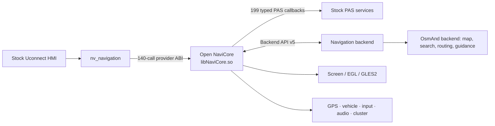

<div align="center">

# Open NaviCore

**An open ARM/QNX navigation provider boundary for the stock Uconnect UI.**

[](#current-status)
[](#current-status)
[](#building)
[](#architecture)
[](#license)

Open NaviCore replaces the proprietary `libNaviCore.so` provider while keeping
its native integration with the stock navigation process and HMI. Behind a
versioned backend seam, an OsmAnd-based backend provides the navigation: a GPU
vector map, offline search, routing and turn-by-turn guidance in the stock
UI's navigation screen.

[Status](#current-status) · [Architecture](#architecture) · [Build](#building) ·
[Contributing](CONTRIBUTING.md) · [Technical reference](docs/technical.md)

</div>

> [!IMPORTANT]
> This is an independent interoperability and research project. It is not
> affiliated with or endorsed by Stellantis, FCA, Panasonic, Uconnect, OsmAnd,
> or their suppliers. Use it only on hardware you own and are authorized to
> modify. Never experiment on a moving vehicle.

## Why this exists

The stock UI already owns the navigation tile, display lifecycle, vehicle-data
feeds, audio coordination, cluster output, and other integration points. Open
NaviCore preserves that contract and moves map/navigation behavior behind a
small backend API. The long-term goal is a native OsmAnd-backed experience that
looks like a first-class stock application.

## Current status

The native boundary is complete for the analyzed QR39.5/QR39.6 stack:

| Surface | Recovered | Notes |
|---|---:|---|
| Provider calls from `nv_navigation` | **140 / 140** | Fixed ABI and lifecycle-gated |
| PAS application callbacks | **199 / 199** | Typed across 25 proxy interfaces |
| Proxy vtable entries | **249 / 249** | Includes 50 destructor entries |
| ABI-unknown callbacks | **0** | No pointer or aggregate fail-closed gaps |
| Backend seam | **v5** | Rendering, input, GPS, vehicle, audio, cluster, i18n, distraction |

The reference backend has been exercised on an unlocked stationary bench unit:
provider initialization, all requested adapters, recurrent HMI replies, GPS
updates, GLES rendering, and Apps → Navigation hide/show all passed without a
radio reboot.

The [OsmAnd backend](backends/osmand/README.md) runs as the unit's navigation
on that bench, installed as the default provider by `navigation.ifs`: vector
map, search, routing and guidance with the Uconnect-style UI, with Open
NaviCore loaded on every boot.

ABI completeness is not feature parity. Of the 199 application callbacks, 80
are currently emitted and 119 are typed dormant seams awaiting meaningful
backend data. Optional phone, traffic, voice, diagnosis, and satellite-radio
behavior is not presented as implemented merely because its ABI is known.

## Architecture



The provider is intentionally split into three layers:

1. **Compatibility boundary** — exact ARM/QNX objects, vtables, exports, and
   calling conventions expected by the stock process.
2. **State and lifecycle layer** — owned copies, asynchronous request/reply
   correlation, rendering lifecycle, and bounded telemetry.
3. **Backend plugin API** — a versioned C interface that can be implemented by
   the reference renderer and the OsmAnd backend.

See [docs/technical.md](docs/technical.md) for the complete object model,
recovered contracts, ownership rules, and runtime behavior.

For product and UI work, read the
[current API/UI restrictions](docs/design/api-ui-restrictions.md) before
treating a recovered callback or stock-looking control as an available feature.

## Repository map

| Path | Purpose |
|---|---|
| [`src/`](src) | Provider: compatibility layer, lifecycle, renderer, backend loader (private headers in `src/include/`) |
| [`include/open_navicore/`](include/open_navicore) | Public backend plugin ABI |
| [`backends/`](backends) | OsmAnd backend (the navigation) and the reference backend |
| [`contracts/`](contracts) | Checked provider and callback compatibility contracts |
| [`tests/`](tests) | Host, lifecycle, stress, ABI and contract checks |
| [`deploy/`](deploy) | `navigation.ifs`: the whole navigation code in one image (ifs-build), and its install |
| [`docs/`](docs) | Technical reference, design constraints, development notes |
| [`cmake/`](cmake) | QNX toolchain file, build helpers |

The reverse-engineering evidence and tooling behind the contracts (Ghidra
scripts, static and cross-version inventories, QNX compiler oracles, the
stock-code replay and the raw-callback capture probe) live in the sibling
research repository `open_navicore-re`, which checks them against this
repository.

## Building

### Requirements

- Linux host with `make`, CMake 3.21+, a C99/C++17 compiler and Python 3
  (host tests)
- For the radio: the QNX SDP 6.6 SDK (sysroot, binutils, mkifs), the OsmAnd
  QNX build tree (GCC 8.5 cross compiler, OsmAnd core, Qt) and, for the
  image, the workspace's `ifs-build`

```sh
make          # the product for the radio (build/qnx)
make ifs      # navigation.ifs: all code for the radio in one image
make test     # host tests and contract checks (build/host; CI)
```

`make test` needs no QNX SDK or stock firmware. Toolchain locations come from
`QNX_SDK`, `QNX_HOST_LIBS`, `OSMAND_QNX_ROOT` and `IFSBUILD_DIR` (make
variables or environment; the defaults are the workspace that holds this
repository, see `cmake/qnx-armv7.cmake`). `make ifs` also needs
`STOCK_NV_NAVIGATION_CFG=<the unit's factory nv_navigation.cfg>` once. No
workstation paths are embedded in the project. See
[validation tiers](docs/development/validation-tiers.md) for what each check
claims.

## Evidence model

Compatibility claims are kept deliberately narrow:

- machine-code evidence establishes register, stack, object, and memory use;
- compiler oracles establish QNX ARM layout and calling-convention candidates;
- runtime traces establish only paths that were actually observed;
- semantic labels never promote a typed telemetry seam into a claimed feature.

The manifests and their checks are part of the product: they prevent a generic
stub, wrong vtable slot, unsafe pointer promotion, or accidental ABI drift from
looking like compatibility. The evidence-side checks (regenerating the
manifests from static inventories, compiler oracles, replay) run in
`open_navicore-re`.

## Roadmap

The evidence-gated implementation plan and current ready points live in
[ROADMAP.md](ROADMAP.md). Thirty FPS is an acceptance floor there, not a cap;
renderer candidates are measured uncapped and higher sustained FPS is preferred.

The [navigation feature landscape](docs/research/navigation-feature-landscape.md)
compares official product capabilities with the stock integration evidence and
proposes design priorities. It describes possible future capabilities, not
current implementation parity.

- [x] Replace the provider without replacing the stock UI
- [x] Recover all stock-reachable provider slots
- [x] Recover all application callback ABIs
- [x] Establish a versioned rendering/data backend seam
- [x] Validate initialization and HMI lifecycle on a bench unit
- [x] Rename the former `mock_*` implementation identifiers to `open_navi_*`
- [x] Add an OsmAnd rendering backend
- [x] Validate the OsmAnd backend on the bench radio (map, search, routing, guidance)
- [ ] Map remaining raw vehicle and cluster enum semantics
- [ ] Expand route guidance, audio prompts, and cluster presentation

## Safety and scope

This repository contains no proprietary firmware binaries, map data, SDK, or
device keys. Do not submit any of those items. Live-device work belongs on an
unlocked stationary bench unit with a known recovery path and a preserved stock
backup.

For contribution rules, evidence standards, and generated-file policy, read
[CONTRIBUTING.md](CONTRIBUTING.md). Security-sensitive reports should follow
[SECURITY.md](SECURITY.md).

## License

No license grant has been selected yet. Copyright law therefore reserves all
rights by default. A project license should be chosen explicitly before others
are invited to redistribute or build derivative releases.
