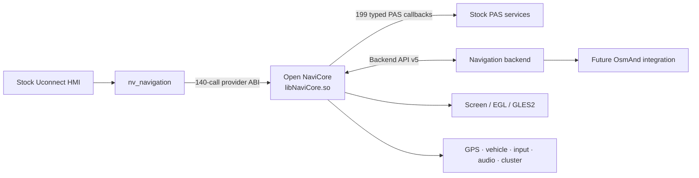

<div align="center">

# Open NaviCore

**An open ARM/QNX navigation provider boundary for the stock Uconnect UI.**

[](#current-status)
[](#current-status)
[](#building)
[](#architecture)
[](#license)

Open NaviCore replaces the proprietary `libNaviCore.so` provider while keeping
its native integration with the stock navigation process and HMI. It exposes a
versioned backend seam intended to host an OsmAnd-based renderer and navigation
engine without replacing the surrounding vehicle UI.

[Status](#current-status) · [Architecture](#architecture) · [Build](#building) ·
[Contributing](CONTRIBUTING.md) · [Technical reference](TECHNICAL.md)

</div>

> [!IMPORTANT]
> This is an independent interoperability and research project. It is not
> affiliated with or endorsed by Stellantis, FCA, Panasonic, Uconnect, OsmAnd,
> or their suppliers. Use it only on hardware you own and are authorized to
> modify. Never experiment on a moving vehicle.

## Why this exists

The stock UI already owns the navigation tile, display lifecycle, vehicle-data
feeds, audio coordination, cluster output, and other integration points. Open
NaviCore preserves that contract and moves map/navigation behavior behind a
small backend API. The long-term goal is a native OsmAnd-backed experience that
looks like a first-class stock application.

## Current status

The native boundary is complete for the analyzed QR39.5/QR39.6 stack:

| Surface | Recovered | Notes |
|---|---:|---|
| Provider calls from `nv_navigation` | **140 / 140** | Fixed ABI and lifecycle-gated |
| PAS application callbacks | **199 / 199** | Typed across 25 proxy interfaces |
| Proxy vtable entries | **249 / 249** | Includes 50 destructor entries |
| ABI-unknown callbacks | **0** | No pointer or aggregate fail-closed gaps |
| Backend seam | **v5** | Rendering, input, GPS, vehicle, audio, cluster, i18n, distraction |

The reference backend has been exercised on an unlocked stationary bench unit:
provider initialization, all requested adapters, recurrent HMI replies, GPS
updates, GLES rendering, and Apps → Navigation hide/show all passed without a
radio reboot.

ABI completeness is not feature parity. Of the 199 application callbacks, 80
are currently emitted and 119 are typed dormant seams awaiting meaningful
backend data. Optional phone, traffic, voice, diagnosis, and satellite-radio
behavior is not presented as implemented merely because its ABI is known.

## Architecture



The provider is intentionally split into three layers:

1. **Compatibility boundary** — exact ARM/QNX objects, vtables, exports, and
   calling conventions expected by the stock process.
2. **State and lifecycle layer** — owned copies, asynchronous request/reply
   correlation, rendering lifecycle, and bounded telemetry.
3. **Backend plugin API** — a versioned C interface that can be implemented by
   the reference renderer today and OsmAnd later.

See [TECHNICAL.md](TECHNICAL.md) for the complete object model, recovered
contracts, ownership rules, and runtime behavior.

## Repository map

| Path | Purpose |
|---|---|
| [`src/`](src) | Provider, lifecycle, renderer, backend loader, and callback code |
| [`include/`](include) | Public and internal ABI declarations |
| [`plugins/`](plugins) | Reference backend and negative-test plugins |
| [`tests/`](tests) | Host, ARM ABI, lifecycle, stress, and manifest checks |
| [`tools/`](tools) | Ghidra scripts, ABI oracles, generators, and replay tooling |
| [`fixtures/`](fixtures) | Deterministic original-code replay fixtures |
| [`deploy/`](deploy) | Bench deployment and control helpers |
| `*.csv` | Checked interface inventories and evidence manifests |

Generated ARM callback tables and checked CSV manifests are intentionally
versioned. Verification compares regenerated output against them.

## Building

### Requirements

- Linux host with `make`, a C99 compiler, Python 3, and POSIX threads
- QNX SDP 6.6 ARMv7 toolchain for target artifacts
- Target headers/libraries for Screen, EGL, and GLES2
- Ghidra only when regenerating static-analysis evidence

The default local SDK paths are documented in the Makefile and can be
overridden with `QNX_SDK`, `HOST_LIBS`, `BUILD_DIR`, and `DIST_DIR`.

```sh
git clone https://github.com/TimbreUnda/open_navicore.git
cd open_navicore

make test
```

`make test` is the portable host suite and requires no QNX SDK or stock
firmware. Target verification is intentionally explicit:

```sh
make verify-qnx    # licensed QNX SDP 6.6 and target graphics libraries
make replay-stock  # locally supplied stock ELF plus Unicorn/Capstone
make verify        # both target and replay verification
```

Useful focused checks:

```sh
make pas-proxy-coverage-selftest
make qnx-arm-abi-oracle-selftest
make arm-snapshot-replay-selftest
make raw-callback-capture-selftest
```

Target artifacts are written to `dist/`, which is intentionally ignored by
Git. See [validation tiers](docs/development/validation-tiers.md) for the exact
claims and inputs of every check.

## Evidence model

Compatibility claims are kept deliberately narrow:

- machine-code evidence establishes register, stack, object, and memory use;
- compiler oracles establish QNX ARM layout and calling-convention candidates;
- runtime traces establish only paths that were actually observed;
- semantic labels never promote a typed telemetry seam into a claimed feature.

The manifests and negative-mutation tests are part of the product: they prevent
a generic stub, wrong vtable slot, unsafe pointer promotion, or accidental ABI
drift from looking like compatibility.

## Roadmap

- [x] Replace the provider without replacing the stock UI
- [x] Recover all stock-reachable provider slots
- [x] Recover all application callback ABIs
- [x] Establish a versioned rendering/data backend seam
- [x] Validate initialization and HMI lifecycle on a bench unit
- [ ] Rename internal `mock_*` implementation identifiers in ABI-safe stages
- [ ] Add an OsmAnd rendering/navigation backend
- [ ] Map remaining raw vehicle and cluster enum semantics
- [ ] Expand route guidance, audio prompts, and cluster presentation

## Safety and scope

This repository contains no proprietary firmware binaries, map data, SDK, or
device keys. Do not submit any of those items. Live-device work belongs on an
unlocked stationary bench unit with a known recovery path and a preserved stock
backup.

For contribution rules, evidence standards, and generated-file policy, read
[CONTRIBUTING.md](CONTRIBUTING.md). Security-sensitive reports should follow
[SECURITY.md](SECURITY.md).

## License

No license grant has been selected yet. Copyright law therefore reserves all
rights by default. A project license should be chosen explicitly before others
are invited to redistribute or build derivative releases.
